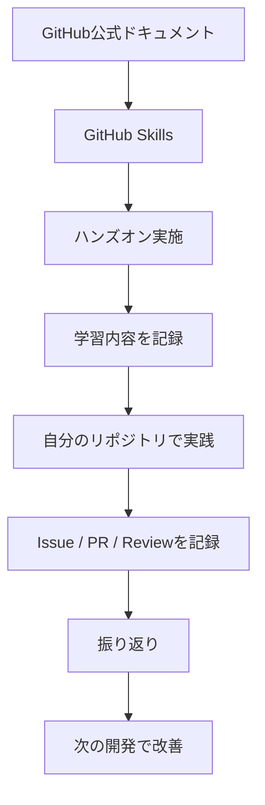

# GitHub Team Development Practice

GitHub を利用したチーム開発に必要な、Issue・Branch・Commit・Pull Request・Code Review の一連の流れを体系的に学習し、実践した記録を残すためのリポジトリです。

## 目的

これまで Git / GitHub の基本的な操作は経験してきましたが、チーム開発を想定した以下のような判断については、まだ十分な経験がありません。

- Issue をどのような単位で立てるか
- Issue と Sub-Issue をどのように使い分けるか
- 作業をどの単位で Branch / Commit に分けるか
- Pull Request をどのような単位で作成するか
- レビュアーが確認しやすい PR をどのように作るか
- レビューをどのタイミング・内容で依頼するか
- レビューコメントや修正対応をどのように残すか
- Issue → PR → Review → Merge までの作業履歴をどのように残すか

本リポジトリでは、GitHub 公式のドキュメントやハンズオンを利用してこれらを学習し、その内容を実際の開発でも実践します。

単に GitHub の操作方法を覚えるのではなく、

> **変更内容を適切な単位に分解し、第三者が目的・変更内容・判断の経緯を追える形で開発を進められるようになること**

を目標とします。

---

## 学習する内容

大きく以下の流れで学習・実践します。

```text
要求・課題
    ↓
Issue
    ↓
Branch
    ↓
Commit
    ↓
Pull Request
    ↓
Self Review
    ↓
Review Request
    ↓
Code Review
    ↓
修正・再レビュー
    ↓
Merge
    ↓
Issue Close
```

特に、GitHub の操作そのものだけでなく、それぞれを**どの単位に分割するか・どのような情報を残すか**を意識して取り組みます。

---

## 学習項目

### 1. Issue

学習・実践する内容：

- Issue の目的
- Issue の作成方法
- 適切な Issue の粒度
- Issue と Sub-Issue の使い分け
- Issue に残すべき情報
- Issue と Pull Request の関連付け

実践では「何を実現するための Issue なのか」を第三者が確認できる状態を意識します。

---

### 2. Branch

学習・実践する内容：

- Issue と Branch の関係
- Branch を作成するタイミング
- 作業途中で変更範囲が大きくなった場合の扱い
- 複数の作業が混在した場合の切り分け

---

### 3. Commit

学習・実践する内容：

- Commit の役割
- 変更を意味のある単位に分割する
- Commit message の書き方
- 後から変更履歴を追いやすい Commit を作る

---

### 4. Pull Request

学習・実践する内容：

- Pull Request の目的
- Issue と Pull Request の関係
- PR の適切な粒度
- 大きくなった PR の分割
- Draft Pull Request
- PR description
- Reviewer の指定
- レビューしてほしいポイントの明示

特に、

> 「この PR では何をレビュー・判断してもらいたいのか」

を説明できる単位で PR を作成することを意識します。

---

### 5. Self Review

レビューを依頼する前に、自分自身で変更内容を確認します。

確認項目：

- 意図していないファイルが含まれていないか
- Issue の目的と変更内容が一致しているか
- PR に複数の目的が混在していないか
- Files changed の内容を第三者が追えるか
- 必要なテスト・Check が完了しているか
- PR の説明だけで変更の目的が理解できるか

---

### 6. Code Review

学習・実践する内容：

- Review Request
- Files changed の確認
- 行単位のコメント
- Suggest changes
- Comment
- Approve
- Request changes
- レビューコメントへの対応
- Re-review
- Conversation の解決

レビューする側・レビューされる側の両方を経験し、変更内容だけでなく、レビューのやり取りそのものも記録として残します。

---

## GitHub 公式ハンズオン

以下の GitHub Skills を利用して、実際に操作しながら学習します。

### Introduction to GitHub

GitHub の基本的な開発フローを復習します。

- Branch
- Commit
- Pull Request
- Merge

[GitHub Skills - Introduction to GitHub](https://github.com/skills/introduction-to-github)

### Review Pull Requests

Pull Request と Code Review を実践します。

- Pull Request
- Review Request
- Review
- Suggest changes
- Apply changes
- Approve
- Merge

[GitHub Skills - Review Pull Requests](https://github.com/skills/review-pull-requests)

### Resolve Merge Conflicts

チーム開発で発生する Merge Conflict とその解決方法を学習します。

[GitHub Skills - Resolve Merge Conflicts](https://github.com/skills/resolve-merge-conflicts)

---

## 学習の進め方

各テーマについて、以下のサイクルで学習します。



### Step 1: 公式情報を確認する

GitHub Docs などから、その機能の目的や推奨される使い方を確認します。

### Step 2: ハンズオンを実施する

GitHub Skills を利用して、実際に操作します。

### Step 3: 学習内容を記録する

操作方法だけでなく、

- 何のための機能なのか
- どのような場面で使うのか
- 今までの自分の認識と何が違ったか

を記録します。

### Step 4: 実際の開発で利用する

自分のリポジトリで Issue / Branch / Commit / PR / Review の流れを実践します。

### Step 5: 振り返る

実際の開発で、

- うまくできたこと
- 判断に迷ったこと
- レビューで指摘されたこと
- 次回改善すること

を記録します。

---

## 実践記録

実際の開発で行った Issue / PR / Review について記録します。

記録では、単にリンクを残すだけではなく、以下の観点で整理します。

### Situation

どのような作業・問題だったか。

### Decision

Issue / PR / Commit などをどのような単位にすることにしたか。

### Reason

なぜその単位・方法を選択したか。

### Result

実際に開発・レビューしてどうだったか。

### Learning

次回同じ状況になったとき、どのように進めるか。

---

## 判断に迷ったケースも記録する

成功したケースだけでなく、判断に迷ったケースも学習記録として残します。

例：

- 1つの PR に複数 Issue の変更が入った
- PR が大きくなりすぎた
- レビュー対象ではない変更が混在した
- 作業途中で PR を分割する必要が出た
- Commit の分け方が適切ではなかった
- レビュー後に追加対応が必要になった
- PR のスコープ外の指摘を別 Issue にする必要があった

このようなケースについて、

```text
問題
 ↓
判断
 ↓
対応
 ↓
結果
 ↓
次回どうするか
```

まで残します。

---

## 到達目標

最終的には、Issue が与えられた後の実装だけでなく、

```text
課題を理解する
    ↓
Issueを適切な単位に整理する
    ↓
作業単位を考える
    ↓
Branch / Commitを整理する
    ↓
レビュー可能なPRを作成する
    ↓
Self Reviewする
    ↓
レビューを依頼する
    ↓
レビューに対応する
    ↓
Mergeする
    ↓
IssueをCloseする
    ↓
第三者が後から経緯を追える状態にする
```

までの一連の流れを、自分で判断しながら進められる状態を目指します。

---

## References

- [GitHub Skills - Introduction to GitHub](https://github.com/skills/introduction-to-github)
- [GitHub Skills - Review Pull Requests](https://github.com/skills/review-pull-requests)
- [GitHub Skills - Resolve Merge Conflicts](https://github.com/skills/resolve-merge-conflicts)
- [GitHub Docs](https://docs.github.com/)
